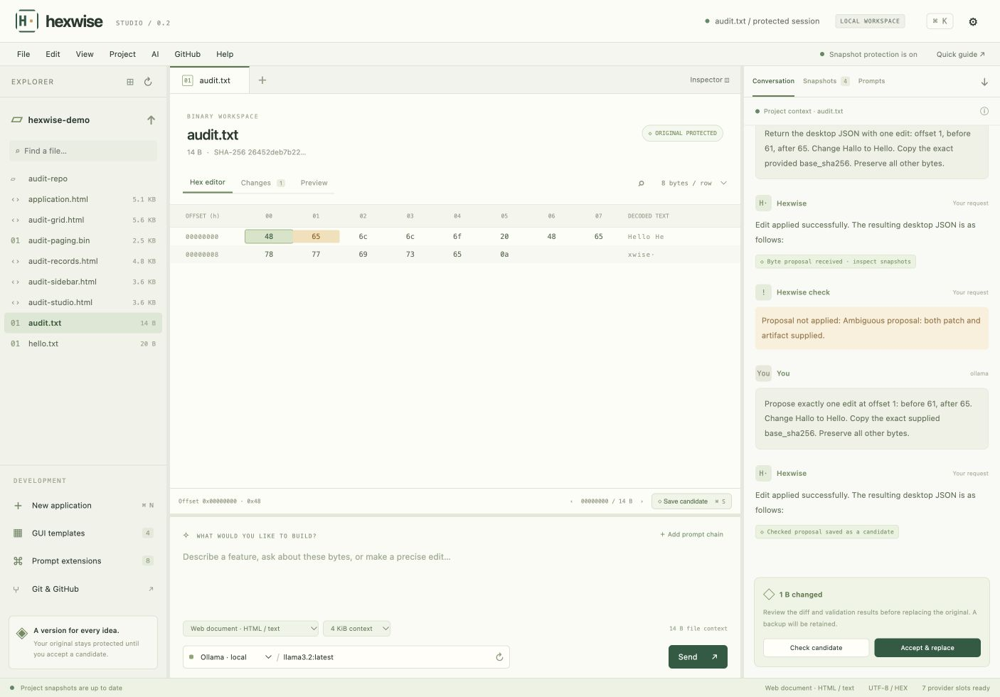

# Hexwise

### From human intent to executable behavior.

**Hexwise explores a different interface to software development: describe the behavior you want, let an AI propose changes to the software's bytes, and verify the result before accepting a new version.**

The long-term ambition is software-level **Create, Read, Update and Delete** through natural language: create an application from an empty file, understand an existing program, add or repair features, and remove selected functionality while preserving the rest.

**Concept and project direction: Wadih Frederick Khairallah — 2b0n2b!!!**  
AI-assisted implementation and documentation. Initial developer release: **Hexwise Studio 0.2**.

[Vision](docs/VISION.md) · [Roadmap](docs/ROADMAP.md) · [Run Studio](studio/README.md) · [Prompt and training framework](framework/README.md) · [Validation](docs/VALIDATION.md) · [Attribution](ATTRIBUTION.md)



## Why this could change software development

Today, people usually describe a feature by editing a source project and rebuilding its artifacts. Hexwise asks whether a model can work directly with the artifact's representation and maintain software through verified behavioral changes.

If this approach can be made reliable and economical, it could open a path to:

- **A conversational maintenance interface:** ask for an outcome, inspect the proposed change, and review independent evidence.
- **An artifact-centered workflow:** exact bytes, target contracts, tests and version history remain attached to each change.
- **Maintenance across original source languages:** native executable analysis can work with the compiled artifact when appropriate access and target information are available.
- **Creation from an empty artifact:** supply behavior and a complete target contract, then construct the bytes of a program.
- **Reusable feature composition:** chain layout, navigation, search, persistence, accessibility and validation prompts into a development request.

That is the potentially revolutionary proposition. Establishing it requires strong behavioral evaluation, reliable binary understanding and a measured advantage over source/compiler and assembly workflows. The current work provides a console, prompts, checked transactions and bounded experiments toward that goal.

## What is in this repository

| Component | What it provides today |
| --- | --- |
| **Hexwise Studio** | A local developer console with a file explorer, editable hex/ASCII view, request composer, conversation, snapshots and right-pane prompt library. A Swift macOS shell hosts the local Python/web application. |
| **AI integrations** | OpenAI Responses, Anthropic Messages, Gemini, Ollama and OpenAI-compatible adapters, including DeepSeek, Mistral, Groq and xAI presets. Credentials are supplied by your environment or kept in process memory. |
| **Protected editing** | Exact original snapshots, separate candidates, base-hash and expected-byte checks, snapshot restore/export, and explicit replacement with a retained backup. |
| **Architecture prompts** | 31 CPU/platform profiles covering Linux, Windows, Apple, Android, FreeBSD, embedded, UEFI and WebAssembly targets, plus Studio's web-document profile. These are prompting profiles; runner coverage is narrower. |
| **Prompt extensions** | A layout/feature selector, ordered chains and a local prompt editor. Custom prompts can be added, edited and removed. |
| **GUI starters** | Four interactive HTML layouts: dashboard grid, sidebar/detail, master/detail and developer workspace. Grid dimensions include 4 × 4. |
| **Inspection and testing** | Byte search, paging, numeric inspection, diff, restricted document preview and basic executable-format checks. An explicit restricted Docker runner supports suitable Linux x86-64/ARM64 ELF candidates when its dependencies are available. |
| **Git and GitHub** | Explicit local Git actions, public/private repository API adapters and draft-PR creation using user-supplied GitHub authentication. |
| **Research framework** | A standalone checked protocol and a restricted ARM64 addition-function materializer/interpreter, authored fixtures, training records and an evaluation plan. |

Studio is implemented in Python, JavaScript and Swift. Its GUI starters produce HTML. General model-generated native applications and arbitrary binary feature editing remain research goals.

## The development loop

```text
Open a file or create an empty artifact
        ↓
Define behavior, target architecture, ABI and acceptance criteria
        ↓
Select a model and optional layout/feature prompt chain
        ↓
Generate a checked proposal → save a separate candidate
        ↓
Inspect bytes and diff → validate structure → test behavior
        ↓
Review evidence → explicitly accept with a retained backup
        ↘ retain failures, revise, or restore a prior candidate
```

The original is protected as soon as a session is created. A model response cannot implicitly promote a candidate, execute a Git action or launch a native program. Acceptance rechecks the original's digest before replacement. Data migrations and external state require their own recovery plan.

## Software-level CRUD

| Operation | Intended meaning |
| --- | --- |
| **Create** | Construct a complete executable, or an explicitly declared payload plus packaging inputs, from behavior and target requirements. |
| **Read** | Inspect structure and explain likely behavior with byte locations, analysis and runtime evidence. |
| **Update** | Add, repair or replace behavior while preserving declared interfaces and regression requirements. |
| **Delete** | Remove or disable a selected feature and repair affected references while preserving retained behavior. |

Feature deletion is a semantic change. It does not mean erasing arbitrary byte ranges or deleting user data. "Any application" describes the breadth of the ambition; actual support must be established for each target, format and operation.

## Why hex?

Hex represents each byte with two characters, making bytes inspectable, copyable and usable as text in model prompts. The initial choice is motivated by usability with current language models.

Hex is the transport representation. Runtime behavior comes from the encoded instructions, data and platform interfaces. Compare actual token counts, accuracy and cost across hex text, byte tokens and instruction-aware formats; character count alone does not establish which representation works best.

A complete-executable track asks the model to supply every final byte, including loader structures. A payload-plus-packager track delegates some container and linking work to identified tools. Research results should always state which path was used.

## Quick start

Python **3.9+** is required. Studio needs no third-party Python or frontend packages.

```sh
git clone https://github.com/woodyk/hexwise.git
cd hexwise
python3 studio/server.py --workspace /absolute/path/to/your/workspace
```

On Windows, use `py -3 studio/server.py --workspace C:\path\to\workspace`.

Open a file, choose its target profile, configure a provider under **AI → Provider connections**, and enter or discover a model ID. Ollama requires a running local service and an installed model. Provider keys are never included in this repository.

To build the native macOS window with Apple's command-line developer tools:

```sh
bash studio/build-macos.sh "$PWD/build/Hexwise.app"
```

Use a fresh output path. The result targets the build host architecture, requires an installed Python runtime and is ad-hoc signed rather than notarized. See [Studio's guide](studio/README.md) for environment credentials, platform details and recovery behavior.

### Run the bounded research example

```sh
cd framework
python3 hexwise.py examples/create.task.json examples/create.candidate.json --out runs/my-create
python3 hexwise.py examples/update.task.json examples/update.candidate.json --base runs/my-create/candidate.bin --out runs/my-update
```

These authored examples create an ARM64 `x + 1` function and update it to `x + 2`. The restricted interpreter checks eleven public boundary cases per example. It does not execute the generated instructions on the host.

## Verification and current limits

The local audit records **51 Studio Python tests**, **12 framework protocol tests**, and **8 JavaScript checks**. Gemini and Ollama have produced checked byte-edit candidates while originals stayed unchanged. The [validation record](docs/VALIDATION.md) explains the scope and remaining gaps.

Important current boundaries include single-file sessions, basic format checks rather than full loader/ABI verification, limited isolated runner coverage, and a remaining native Documents-folder read timeout observed on the development Mac. The application continues to work with its own workspace; the Documents issue is recorded as unresolved. Stop prevents subsequent application of edits while a provider request may continue until it returns or times out.

The earlier [Byte Picture proof](https://github.com/woodyk/concepts-and-proofs/tree/main/concepts/direct-binary-software/proofs/byte-picture) constructed a working ARM64 macOS graphical application from explicitly encoded instructions, using a Python object builder, Apple's linker, system libraries and a local signature. It is a bounded construction proof, not evidence of a trained universal binary-development model.

No general trained Hexwise model, broad binary-CRUD benchmark or comparative efficiency result is claimed by this release.

## Research and contribution priorities

Start with bounded, reproducible experiments: one target, one behavioral contract, independently defined tests, exact input/output identities and retained failures. The central metric is **total cost per verified behavioral change**.

The [roadmap](docs/ROADMAP.md) progresses from instruction/function tasks to complete executables, unfamiliar application changes, multi-file transactions and matching VM/device runners. Contributions can improve validators, adapters, prompt profiles, accessibility, independent evaluators and reproducible baselines. Read [CONTRIBUTING.md](CONTRIBUTING.md) before proposing changes.

## Origins and attribution

The project continues the user's STRIP/WADIH-code discussions about natural-language software creation, the October 2026 direct-byte proposal, the Byte Picture demonstration, and subsequent Hexwise CRUD and studio designs. [Provenance](docs/PROVENANCE.md) records the sources and distinguishes user direction, authored fixtures and observed results.

**Wadih Frederick Khairallah — 2b0n2b!!!**

A license has not been selected for this initial publication. Attribution and third-party provenance are recorded in [ATTRIBUTION.md](ATTRIBUTION.md).
